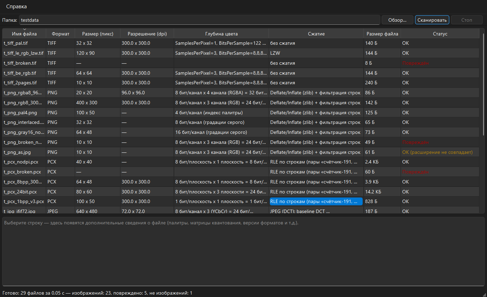

# Лабораторная работа 2. Чтение информации из графических файлов

Приложение на Qt 6 / C++ сканирует папку (до 100 000 файлов) и показывает в таблице
основную информацию об изображениях в форматах **BMP, PNG, GIF, JPEG, TIFF, PCX**:

* имя файла;
* размер изображения (в пикселях);
* разрешение (dot/inch);
* глубина цвета;
* сжатие (для форматов, где оно задаётся);
* размер файла, статус целостности, дополнительные сведения (палитры, матрица
  квантования JPEG, число кадров GIF, версии форматов и т.д.).

Повреждённые файлы и файлы с подменённым расширением не «роняют» программу —
им присваивается статус и причина.



## Как «доставались» данные

Сторонние библиотеки для чтения метаданных **не используются** (Qt привлекается
только для интерфейса). Каждый файл открывается как бинарный поток, и из него
читаются **только заголовки и нужные смещения** — по спецификациям форматов:

| Формат | Сигнатура | Что читается |
|---|---|---|
| BMP | `BM` | BITMAPFILEHEADER (14 байт) + BITMAPINFOHEADER/V4/V5/CORE: размеры, `biBitCount`, `biCompression`, `biXPelsPerMeter`/`biYPelsPerMeter` (пикс/м → dpi × 0,0254), размер палитры, проверка «файл не короче заголовка + растр» |
| PNG | `89 50 4E 47 0D 0A 1A 0A` | IHDR (ширина/высота, бит на канал, тип цвета, интерlace), обход чанков по смещениям: pHYs (разрешение), PLTE (палитра), обязательность IEND |
| GIF | `GIF87a/89a` | Дескриптор логического экрана (размер, палитра 2^(N+1)), обход блоков до трейлера `0x3B` (кадры, локальные палитры, мин. размер кода LZW) |
| JPEG | `FF D8 FF` | Обход маркеров до SOS: SOFn (размеры, точность, число компонент, baseline/progressive), APP0 JFIF (плотность, единицы dpi/dpcm), APP1 Exif (XResolution/YResolution — разбор встроенного TIFF-IFD), DQT (матрицы квантования), наличие EOI в конце файла |
| TIFF | `II*\0` / `MM\0*` | Заголовок (порядок байтов), цепочка IFD: ImageWidth/Length, BitsPerSample, SamplesPerPixel, Compression, Photometric, XResolution/YResolution (рациональные) + ResolutionUnit; multi-page |
| PCX | `0x0A` | 128-байтный заголовок: версия, encoding (RLE), биты/плоскость, плоскости, габариты, hres/vres, палитра 16 цветов; для 8-бит версии 5 — палитра 256 цветов (769 байт от конца) |

Каждая выводимая характеристика поясняется в самом приложении: подсказки у
заголовков столбцов и меню «Справка → Откуда берутся данные…» (что поле означает,
зачем нужно и в каком поле заголовка хранится для каждого формата).

## Архитектура (слои Model / ViewModel / View)

| Слой | Каталог | Содержимое | Зависимости |
|------|---------|------------|-------------|
| **Model** | `model/` | Парсеры заголовков (`BmpParser`, `PngParser`, `GifParser`, `JpegParser`, `TiffParser`, `PcxParser`), диспетчер по сигнатуре `ImageInfoReader`, потоковый читатель `ByteReader`. Чистый C++17 (только STL), без Qt. | STL |
| **ViewModel** | `viewmodel/` | `FolderScanner` — многопоточный обход папки (`QtConcurrent::mapped`), батч-подача результатов (каждые 80 мс), отмена, статистика. | Qt Core/Concurrent, Model |
| **View** | `view/` | `MainWindow` — таблица (сортировка, подсказки, статусы с цветовой маркировкой), панель дополнительных сведений, справка, прогресс-бар. | Qt Widgets, ViewModel |

## Быстродействие (ленивое чтение + многопоточность)

Файл никогда не читается целиком: открывается дескриптор, считываются заголовки
(обычно первые 64–1024 байта, для JPEG — цепочка маркеров до SOS + 64 КБ хвоста
для проверки EOI, для PCX — 769 байт от конца), после чего дескриптор закрывается.
Пиксельные данные не читаются вовсе.

Замер (SSD, папка **600 jpeg-файлов общим объёмом 1,92 ГБ**, 2048×1536, q95):

* GUI-приложение (пул потоков QtConcurrent): **600 файлов за 0,10 с**;
* консольный однопоточный прогон тех же файлов: 0,11 с.

Интерфейс при сканировании не блокируется: сканирование идёт в фоновом пуле
потоков, строки добавляются в таблицу батчами, прогресс отражается в панели
инструментов, кнопка «Стоп» прерывает обход.

Проверка корректности: вывод сверен с независимой эталонной реализацией на
Python (24 тестовых BMP из архива «Для проверки Lab2» и 29 сгенерированных
файлов всех форматов, включая битые и с подменёнными расширениями) — 0
расхождений по формату, размерам, dpi, глубине цвета и статусам.

## Сборка

Комплект: Qt 6.11.0 (MinGW 64-bit), CMake, Ninja.

**Qt Creator:** открыть `CMakeLists.txt`, выбрать комплект Desktop Qt 6.11.0
MinGW 64-bit, собрать и запустить (qmake не используется).

**Командная строка (PowerShell):**

```powershell
$env:Path = "E:\Qt\Tools\CMake_64\bin;E:\Qt\Tools\Ninja;E:\Qt\Tools\mingw1310_64\bin;E:\Qt\6.11.0\mingw_64\bin;" + $env:Path
cmake -G Ninja -DCMAKE_BUILD_TYPE=Release -DCMAKE_PREFIX_PATH=E:/Qt/6.11.0/mingw_64 -S . -B build
cmake --build build
build\Lab2ImageInfo.exe                       # приложение (можно передать папку аргументом)
```

## Готовая сборка (папка deploy/)

`deploy/` содержит рабочее приложение и минимальный набор DLL (10 файлов):
`Lab2ImageInfo.exe`, `Qt6Core.dll`, `Qt6Gui.dll`, `Qt6Widgets.dll`,
`Qt6Concurrent.dll` (пул потоков сканера), рантайм MinGW (`libgcc_s_seh-1.dll`,
`libstdc++-6.dll`, `libwinpthread-1.dll`), платформенный плагин
`platforms/qwindows.dll` (окно, ввод, DPI) и плагин стиля
`styles/qmodernwindowsstyle.dll`. Запускается на любом Windows 10/11 x64 без
установки Qt; после пересборки достаточно скопировать exe в `deploy/`.

## Структура проекта

```
Lab2ImageInfo/
├── CMakeLists.txt              # 3 цели: imagecore, scannerviewmodel, Lab2ImageInfo
├── model/                      # Model: парсеры заголовков 6 форматов (чистый C++)
├── viewmodel/FolderScanner.*   # ViewModel: многопоточный сканер папки
├── view/                       # View: MainWindow, main.cpp
├── docs/                       # скриншоты
└── deploy/                     # готовый exe + минимальный набор DLL (10 файлов)
```
