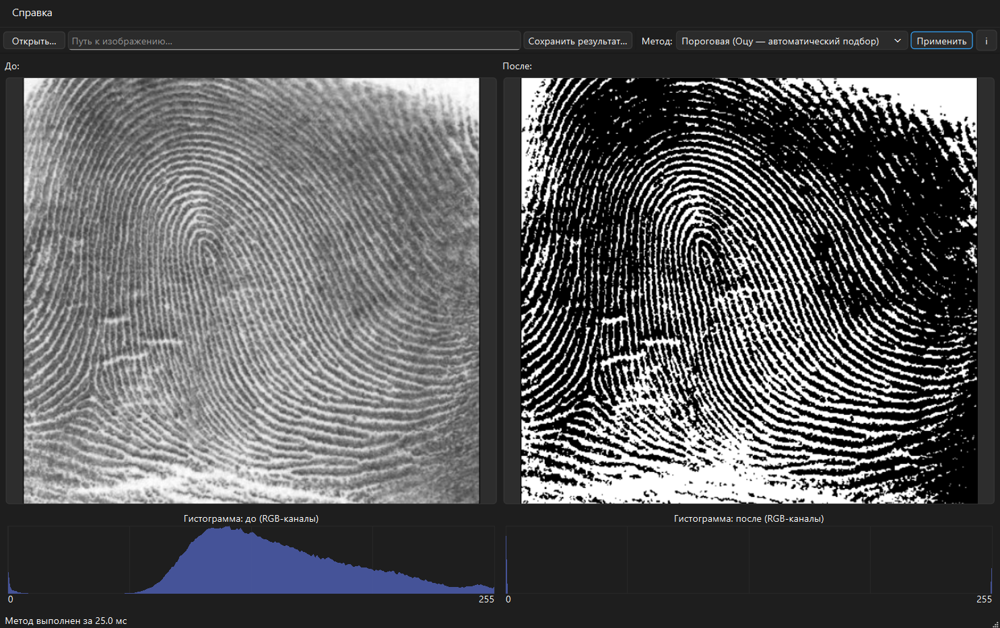
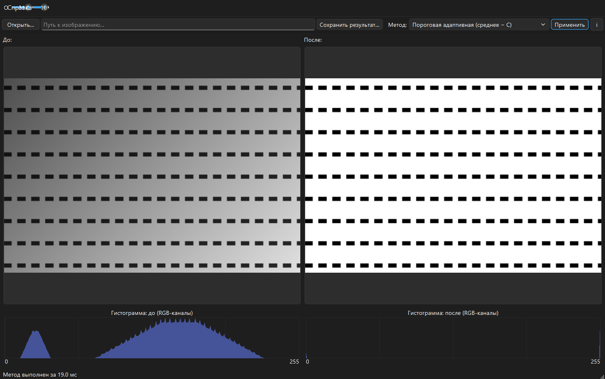

# Лабораторная работа 3. Обработка цифровых изображений — вариант 7

Приложение на Qt 6 / C++ применяет к изображениям методы обработки **варианта 7**:

* **Низкочастотные (сглаживающие) фильтры**: прямоугольный (box) и гауссов,
  с выбором способа обработки краёв (Clamp / Reflect);
* **Глобальная пороговая обработка (2 метода)**: ручной порог ползунком и
  автоматический подбор порога **методом Оцу**;
* **Адаптивная пороговая обработка** (алгоритм из лекции): порог = средняя
  яркость в скользящем окне минус C; окно и C настраиваются.

Дополнительно (помечены «Доп.» в интерфейсе): перевод в градации серого,
линейное контрастирование, глобальная эквализация гистограммы (серое /
RGB / HSV), резкость (лапласиан 4- и 8-связный, нерезкое маскирование) —
они используются для подготовки тестовых изображений и сравнения.




## Как устроено (слои Model / ViewModel / View)

| Слой | Каталог | Содержимое | Зависимости |
|------|---------|------------|-------------|
| **Model** | `model/` | `Image8` — RGB24-буфер пикселей (+PPM-ввод/вывод для тестов); `Contrast` — гистограммы и LUT-преобразования; `Filters` — свёртка, box/гаусс (разделяемо), лапласиан, unsharp mask, 2 стратегии краёв; `Threshold` — ручной порог, Оцу, адаптивный (интегральное изображение); `Degradations` — генераторы тестовых искажений. Чистый C++17. | только STL |
| **ViewModel** | `viewmodel/` | `ProcessingController` — приём параметров, выполнение метода в фоновом потоке (QtConcurrent), сигналы старта/завершения с временем. | Qt Core/Concurrent/Gui |
| **View** | `view/` | `MainWindow` — «до/после», панель параметров (видны только нужные методу ползунки), справка с формулами, кнопка «i»; `HistogramWidget` — рисование гистограмм RGB-каналов. | Qt Widgets |

Все алгоритмы написаны **с нуля** на C++ (вложенные циклы по пиксельному буферу);
сторонние библиотеки обработки не используются. Qt служит только для интерфейса
и загрузки/сохранения файлов.

## Методы (краткая теория)

**Свёртка и края.** g(x,y) = ΣΣ K(i,j)·f(x+i−r, y+j−r). У границ окрестность
выходит за картинку; реализованы 2 стратегии: **Clamp** (дублирование граничного
пикселя) и **Reflect** (зеркальное отражение: −1 → 1, n → n−2).

**Прямоугольный фильтр** — среднее по окну (2r+1)² с равными весами.
**Гауссов фильтр** — веса K(i) ∝ exp(−d²/2σ²), σ = r/3, нормировка на сумму;
вычисляется разделяемо: два прохода одномерным ядром (строки → столбцы),
что снижает сложность с O(K²·N²) до O(K·N²) при идентичном результате.

**Бинаризация.** Яркость = 0,299R + 0,587G + 0,114B; пиксель > порога → 255, иначе 0.
**Ручной порог** — значение задаётся ползунком. **Метод Оцу** — перебор всех 256
порогов, максимизация межклассовой дисперсии
σ²(t) = ω₀(t)·ω₁(t)·(μ₀(t) − μ₁(t))², где ω — доли и μ — средние яркости
«фона» и «объекта»; наилучший порог делит гистограмму на два максимально
различающихся класса. Работает на бимодальных гистограммах.

**Адаптивная пороговая обработка** (лекционный алгоритм Брэдли/«среднее − C»):
T(x,y) = средняя яркость в окне (2r+1)×(2r+1) вокруг пикселя − C;
пиксель > T → 255. Спасает при неравномерном освещении, где глобальный порог
превращает тёмные области в сплошную заливку. Сумма по окну вычисляется через
**интегральное изображение** (SAT) за O(1) на пиксель — размер окна не влияет
на скорость (для 640×420 с окном 31 — единицы миллисекунд).

## Тестирование

Автотесты сверяют вывод программы с **независимой эталонной реализацией на
Python** (`scripts/reference_check.py` в рабочей копии проекта): те же методы
написаны второй раз независимо, обмен через PPM. Проверяется побайтовое
совпадение результатов на синтетических (градиент, шахматная доска, пятна,
полосы) и реальных изображениях для всех методов и обеих стратегий краёв;
статистика деградаций (СКО шума ≈ σ, доля salt&pepper ≈ p) — в допуске.

**Результат: 103/103 тестов пройдено, 0 расхождений** (байтовая идентичность
результатов свёрток, LUT, пороговых методов; совпадение порога Оцу).

База тестовых изображений (`testimages/`, 126 файлов): 24 фотографии из архива
«Для проверки Lab2» (уменьшенные до 640 px копии) + их деградированные версии —
зашумлённые (гауссов шум σ=25, salt&pepper 5%), размытые (box r=2),
малоконтрастные (сжатие диапазона 70–170) — и синтетика: градиент, шахматная
доска, радиальные пятна, полосы, «документ с неравномерной подсветкой»
(для демонстрации, где только адаптивная пороговая обработка даёт результат).

## Сборка

Комплект: Qt 6.11.0 (MinGW 64-bit), CMake, Ninja.

**Qt Creator:** открыть `CMakeLists.txt`, выбрать комплект Desktop Qt 6.11.0
MinGW 64-bit, собрать и запустить.

**Командная строка (PowerShell):**

```powershell
$env:Path = "E:\Qt\Tools\CMake_64\bin;E:\Qt\Tools\Ninja;E:\Qt\Tools\mingw1310_64\bin;E:\Qt\6.11.0\mingw_64\bin;" + $env:Path
cmake -G Ninja -DCMAKE_BUILD_TYPE=Release -DCMAKE_PREFIX_PATH=E:/Qt/6.11.0/mingw_64 -S . -B build
cmake --build build
build\Lab3ImageProcessing.exe
```

## Готовая сборка (папка deploy/)

`deploy/` — exe + минимальный набор DLL (12 файлов): Qt6Core/Gui/Widgets/Concurrent,
рантайм MinGW, платформенный плагин `platforms/qwindows.dll`, плагин стиля и
плагины форматов `imageformats/` (JPEG/GIF/TIFF для открытия файлов). Запускается
на любом Windows 10/11 x64 без установки Qt; после пересборки достаточно
скопировать exe.

## Структура проекта

```
Lab3ImageProcessing/
├── CMakeLists.txt                    # 3 цели: imagalgorithms, processingviewmodel, приложение
├── model/                            # Model: буфер + алгоритмы (чистый C++, без Qt)
├── viewmodel/ProcessingController.*  # ViewModel: фоновая обработка, прогресс, тайминг
├── view/                             # View: MainWindow, HistogramWidget, main.cpp
├── docs/                             # скриншоты
└── deploy/                           # готовый exe + минимальный набор DLL
```
